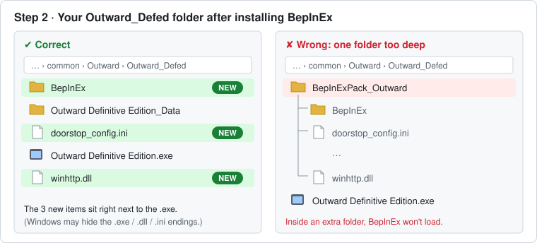
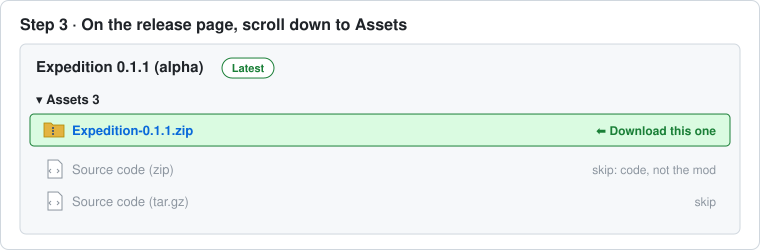
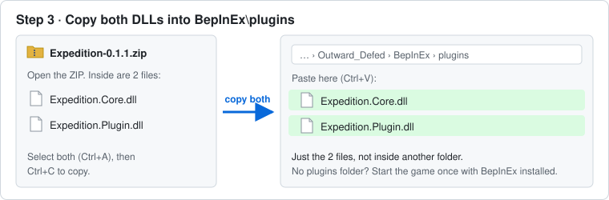

# Expedition

A co-op expansion for **Outward Definitive Edition** (BepInEx 5, C#): bigger parties
(4 players to start), better co-op sync, and waymarks (pings) your party can see.

### ⬇️ [Download the latest version](https://github.com/LynzTighers/Expedition/releases/latest) · 📖 [How to install](#install)

> **Status: alpha. Tested with 3 players; not yet with 4.** Expect some bugs when more than
> 2 people play together. Please report what happens (see [Reporting problems](#reporting-problems)).

## What it does right now

| Feature | Status |
|---|---|
| Online rooms hold **4 players** instead of 2 | ✅ Works: tested with 3 players. Not yet tested with 4. |
| **Nameplates:** other players' names on their health bar, visible at any distance | 🆕 0.2.0, not yet tested in-game |
| **Shared quest rewards:** every player gets the quest's items, skills, silver and XP | 🆕 0.2.0, not yet tested in-game |
| **Shared silver:** silver looted from chests, enemies or the ground is split evenly | 🆕 0.2.0, not yet tested in-game |
| **Shared loot:** take an item from a chest or enemy and everyone else gets their own copy | 🆕 0.2.0, not yet tested in-game |
| **Pings:** press the **middle mouse button** to mark the spot in front of you. Everyone sees `Name · 24 m ▼` there for 20 seconds | 🆕 0.2.0, not yet tested in-game |

Each feature can be turned off: see [Settings](#settings).

### 3-player test results

| What | Result |
|---|---|
| Third player joins (no stuck loading screen) | ✅ Works |
| Everyone sees each other move and fight | ✅ Works |
| Dropped items show up for everyone | ✅ Works |
| Going down and being revived | ✅ Works |
| No errors in the log | ✅ Works |
| Compass markers | ⚠️ Bug in 0.1.0: the first two players didn't see the third on their compass. Fixed in 0.1.1, not yet re-tested |
| Quest progress for every player | ❔ Not tested yet |

Normal single-player and 2-player co-op play as usual.

---

## Install

**Everyone in the group installs it, including the host.** It takes about 10 minutes.
You'll download two ZIP files:

| Download | What it is | Where |
|---|---|---|
| **BepInExPack_Outward** | The mod loader. Lets Outward run mods. | [Thunderstore](https://thunderstore.io/c/outward/p/BepInEx/BepInExPack_Outward/): click **Download** on the right |
| **Expedition-x.y.z.zip** | This mod | [Latest release](https://github.com/LynzTighers/Expedition/releases/latest): see step 3 |

> Already have BepInEx working for Outward (for example from another mod)? Skip to [step 3](#step-3-install-expedition).

### Step 1: Switch Outward to the Mono version

BepInEx only works on this version of the game.

1. Open **Steam** → **Library**.
2. Right-click **Outward** → **Properties…**
3. Click **Betas** on the left.
4. In the **Beta Participation** drop-down, choose **default-mono**.
5. Close the window and wait for Steam to finish the update before you go on.

### Step 2: Install BepInEx

**2a. Download and unzip it**

1. Download **BepInExPack_Outward** from
   [Thunderstore](https://thunderstore.io/c/outward/p/BepInEx/BepInExPack_Outward/)
   (the **Download** button on the right).
2. In your **Downloads** folder, right-click the ZIP → **Extract All…** → **Extract**.
   This makes a normal folder. **Don't** extract it into the game folder.
3. Open the new folder, then open the **`BepInExPack_Outward`** folder inside it.
   You'll see 3 things: the `BepInEx` folder, `winhttp.dll` and `doorstop_config.ini`.
   Leave this window open.

**2b. Open the game folder**

1. In Steam, right-click **Outward** → **Manage** → **Browse local files**.
   A folder called `Outward` opens.
2. Double-click the **`Outward_Defed`** folder. This is the Definitive Edition.
   You're in the right place if you see **`Outward Definitive Edition.exe`**.

   ⚠️ Don't use the outer `Outward` folder (the one with the classic `Outward.exe`).
   BepInEx won't load from there.

**2c. Move the 3 files in**

1. Go back to the `BepInExPack_Outward` window, press **Ctrl+A** to select all 3 items,
   then **Ctrl+C** to copy them.
2. Click into the `Outward_Defed` window and press **Ctrl+V** to paste.

When you're done, `Outward_Defed` should look like the left side, not the right:



**2d. Let BepInEx set itself up**

Start Outward once, wait for the main menu, then quit. This creates the
`Outward_Defed\BepInEx\plugins` folder you need in step 3.

### Step 3: Install Expedition

**3a. Download the mod**

1. Open the [latest release](https://github.com/LynzTighers/Expedition/releases/latest).
2. Scroll down to **Assets** and click **`Expedition-x.y.z.zip`**.
   Don't download "Source code": that's the code, not the mod.



If your browser warns about the download, choose **Keep**. Small mod files often get this
warning.

**3b. Copy the 2 DLLs into the plugins folder**

1. Open the ZIP (double-click it). Inside are **`Expedition.Core.dll`** and
   **`Expedition.Plugin.dll`**. Select both and press **Ctrl+C**.
2. In the game folder, open **`Outward_Defed`** → **`BepInEx`** → **`plugins`**.
3. Press **Ctrl+V** to paste. If Windows asks to replace older files, choose **Replace**.



Using another co-op mod such as **Raid Mode**? Remove it from `plugins`. They change the
same things.

### Step 4: Check that it worked

1. Start Outward and wait for the main menu.
2. Open `Outward_Defed\BepInEx\LogOutput.log` (double-click it; it opens in Notepad).
3. Press **Ctrl+F** and search for `Expedition`. You should find:

```
[Info   :   BepInEx] Loading [Expedition 0.2.0]
[Info   :Expedition] THis mod has loaded!
[Info   :Expedition] Room limit raised to 4 players.
[Info   :Expedition] Pings: True (key: Mouse2)
[Info   :Expedition] Nameplates: True, shared quest rewards: True, shared silver: True, shared loot: True
```

🎉 That's it. The version number should match the ZIP you downloaded.

### Something's not right?

| What you see | Fix |
|---|---|
| No `LogOutput.log` file at all | BepInEx isn't loading. Check step 1 (default-mono) and step 2c (files next to `Outward Definitive Edition.exe`, not inside another folder). |
| No `plugins` folder inside `BepInEx` | Start the game once (step 2d), or create a folder named `plugins` yourself. |
| Log has no `Expedition` lines | The DLLs aren't in `BepInEx\plugins`, or they're inside an extra folder there. |
| Log shows an old version number | You still have old DLLs. Delete both Expedition DLLs from `plugins` and copy the new ones in. |
| Mod still doesn't load | Right-click each DLL → **Properties**. If there's an **Unblock** box at the bottom, tick it and click **OK**. |

## Play together

1. The host loads their character and hosts an online game as usual.
2. Everyone else joins it as usual.
3. Everyone should use the **same Expedition version** (check step 4).

The game's menus still show 2 players. That's expected: the limit is raised behind the
scenes, and the menus haven't been updated yet.

### Pinging

Aim at something and click the **middle mouse button** (the scroll wheel). Everyone in the
group sees a yellow marker with your name and how far away it is, and gets a
"*Name* pinged a spot" message. A new ping replaces your old one. Pings disappear after
20 seconds. You can change the key and the time in [Settings](#settings).

### How sharing works

| What | How it's shared | Notes |
|---|---|---|
| **Quest rewards** | Everyone gets the full reward | Decided by the **host's** settings |
| **Silver** | Split evenly; the looter keeps any leftover (10 silver, 3 players → 4 / 3 / 3) | From chests, enemy bodies and the ground. Never from a player's own pouch, bag or stash |
| **Items** | Everyone else gets their own copy, with a "received" message | Only from chests and enemy bodies, not items lying on the ground (so dropped gear can't be duplicated). Silver and gold aren't copied, they're split |

## Settings

Start the game once with Expedition installed. BepInEx then creates
`Outward_Defed\BepInEx\config\com.lynztighers.expedition.cfg`. Open it with Notepad and
change `true` to `false` for anything you want off, then restart the game:

```ini
[Party]
Nameplates = true
Pings = true
PingKey = Mouse2
PingSeconds = 20

[Sharing]
ShareQuestRewards = true
ShareSilver = true
ShareLoot = true
```

`PingKey = Mouse2` is the middle mouse button. Other examples: `G`, `T`, `Mouse3`.

Everyone in the group should use the same settings.

## Update to a new version

Download the new ZIP (step 3a) and copy both DLLs into `plugins` again, choosing **Replace**.

## Uninstall

Delete `Expedition.Plugin.dll` and `Expedition.Core.dll` from `BepInEx\plugins\`.

## Reporting problems

Open an issue, or message the author, with:

- how many players were in the game, and who was the host
- what happened, and what you expected
- each player's `BepInEx\LogOutput.log` from that session, especially red error lines

---

## For developers

See [How the source code works](src/README.md).

```
src/Expedition.Core/          pure C# logic, no Unity (netstandard2.0)
tests/Expedition.Core.Tests/  xUnit tests (net8.0)
src/Expedition.Plugin/        BepInEx plugin that runs inside Outward
```

Build the plugin (needs the .NET SDK; packages come from nuget.org and the BepInEx feed,
see `NuGet.Config`):

```bash
dotnet build src/Expedition.Plugin/Expedition.Plugin.csproj
```

The DLLs land in `src/Expedition.Plugin/bin/Debug/net472/`.

## Credits

Inspired by [Raid Mode](https://www.nexusmods.com/outward/mods/183) by SpicerXD.

Developed with the help of AI coding tools (Claude Code), used for research,
explanations and code review while I learned C# and Outward modding.

## License

[MIT](LICENSE)
